# Doc Tascabile

**[English](#english)** · **[Italiano](#italiano)**

Documents, PDFs, slides and spreadsheets on the phone, offline, made for the finger. · Documenti, PDF, slide e fogli di calcolo sul telefono, senza rete, fatti per il dito.

Version 0.9.0 beta · Android 11 or later · not on Google Play: test builds are shared by hand.

<p align="center">
  <a href="https://github.com/Daveide90/doc-tascabile/releases/latest/download/DocTascabile.apk">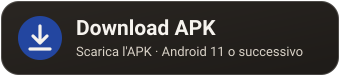</a>
</p>
<p align="center"><sub><a href="https://github.com/Daveide90/doc-tascabile/releases">All versions, notes and SHA-256 · Tutte le versioni, note e SHA-256</a></sub></p>

<table>
<tr><td align="center" width="25%">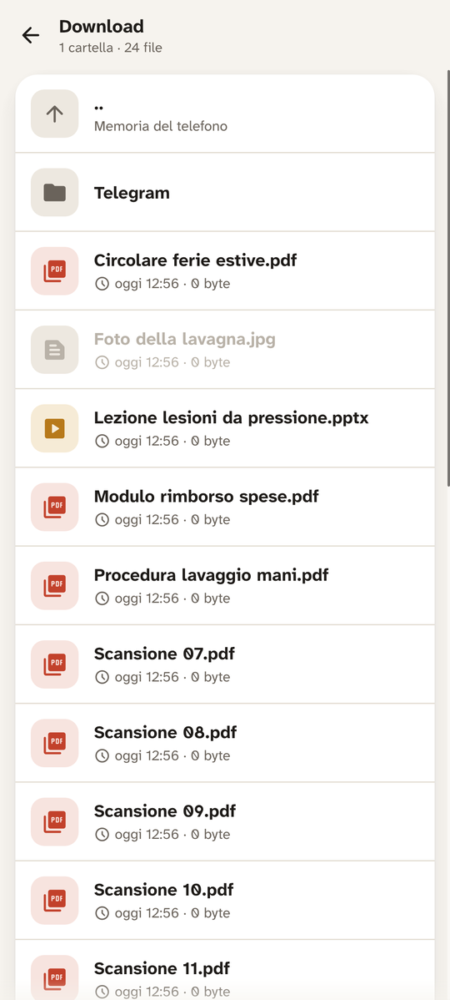</td><td align="center" width="25%">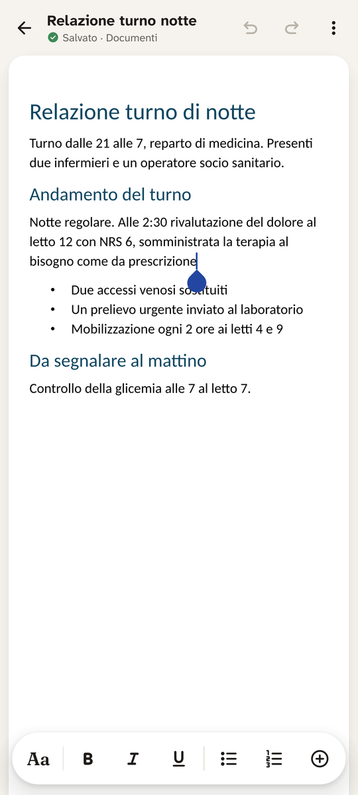</td><td align="center" width="25%">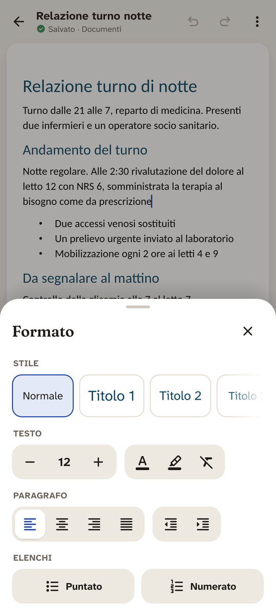</td><td align="center" width="25%">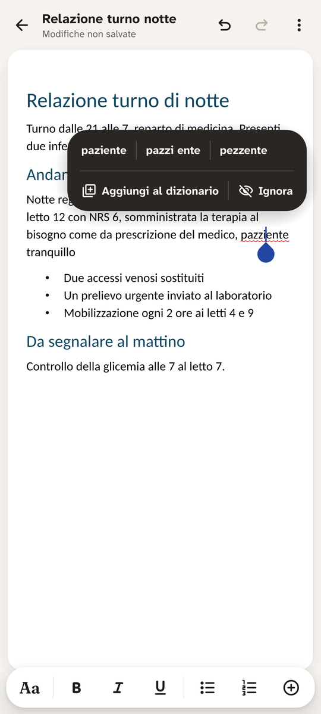</td></tr>
<tr><td align="center"><b>Folders</b> · Cartelle</td><td align="center"><b>Writing</b> · Scrittura</td><td align="center"><b>Format</b> · Formato</td><td align="center"><b>Spelling</b> · Ortografia</td></tr>
<tr><td align="center" width="25%">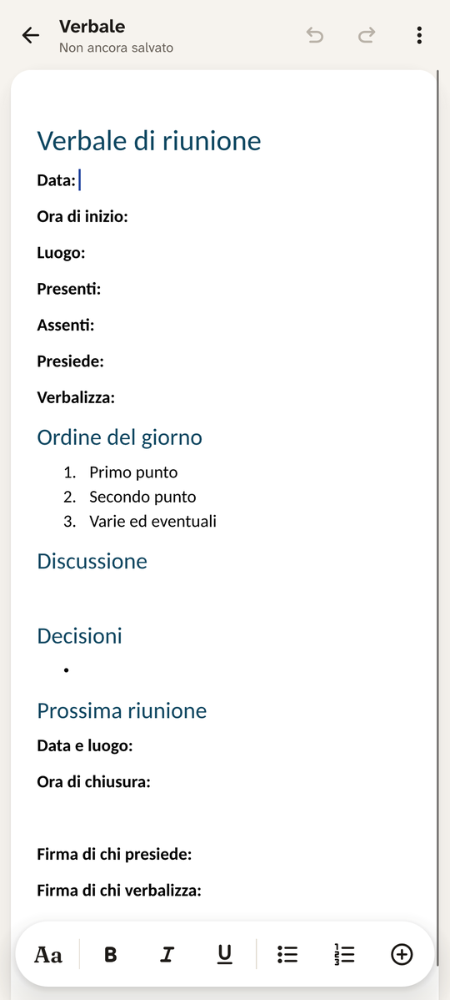</td><td align="center" width="25%">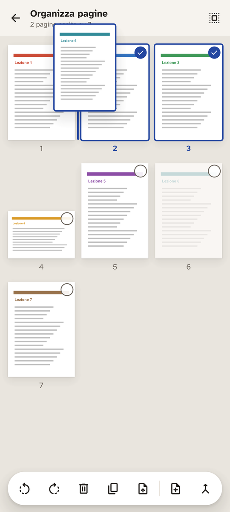</td><td align="center" width="25%">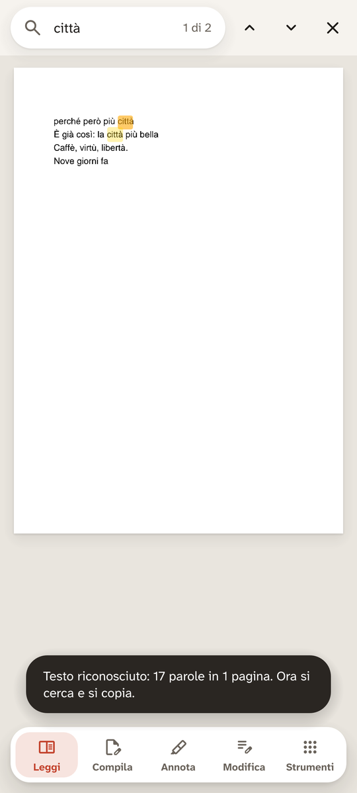</td><td align="center" width="25%">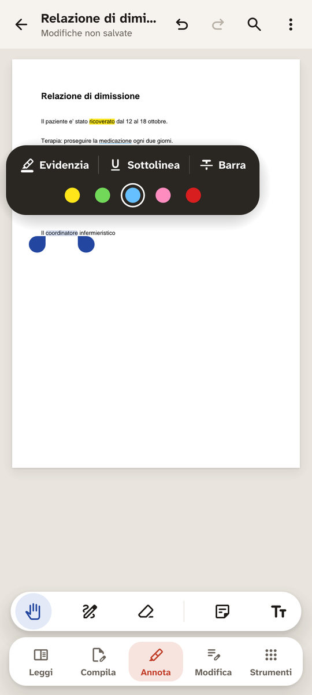</td></tr>
<tr><td align="center"><b>Templates</b> · Modelli</td><td align="center"><b>PDF pages</b> · Pagine PDF</td><td align="center"><b>Text recognition</b> · Testo riconosciuto</td><td align="center"><b>Annotate</b> · Annota</td></tr>
<tr><td align="center" width="25%">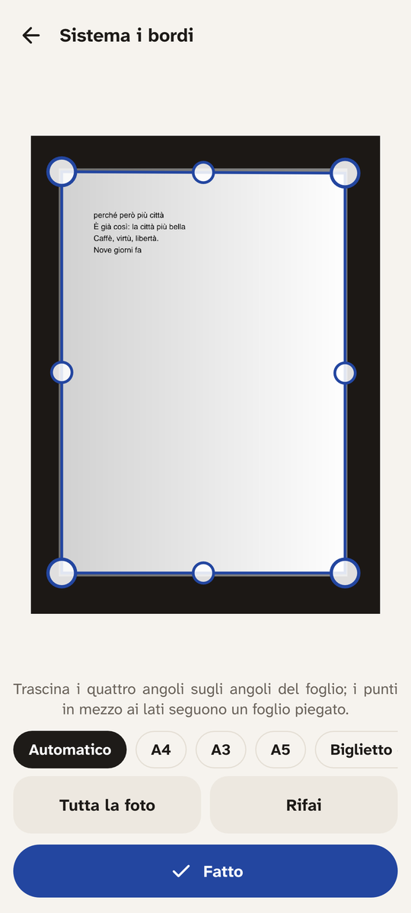</td><td align="center" width="25%">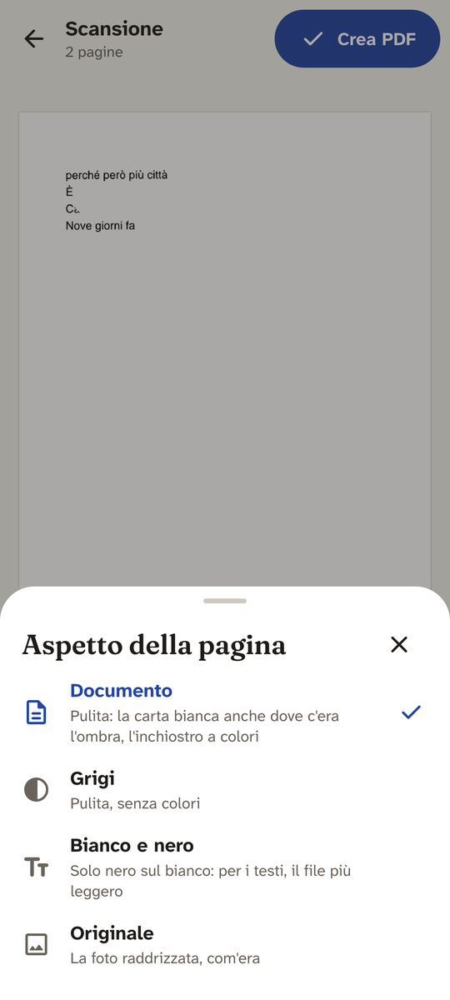</td><td align="center" width="25%">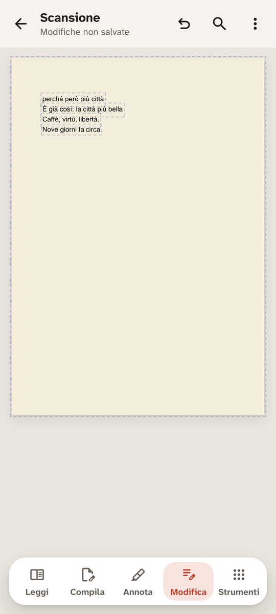</td><td align="center" width="25%">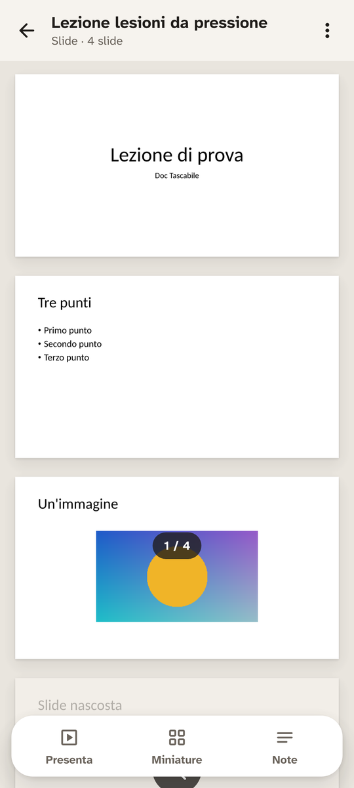</td></tr>
<tr><td align="center"><b>Scan edges</b> · Bordi</td><td align="center"><b>Scan look</b> · Aspetto</td><td align="center"><b>Fix a scan</b> · Correggere</td><td align="center"><b>Slides</b> · Slide</td></tr>
<tr><td align="center" width="25%">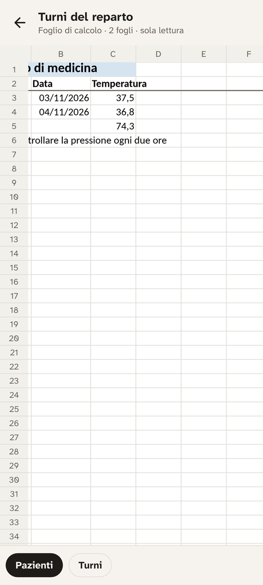</td><td align="center" width="25%">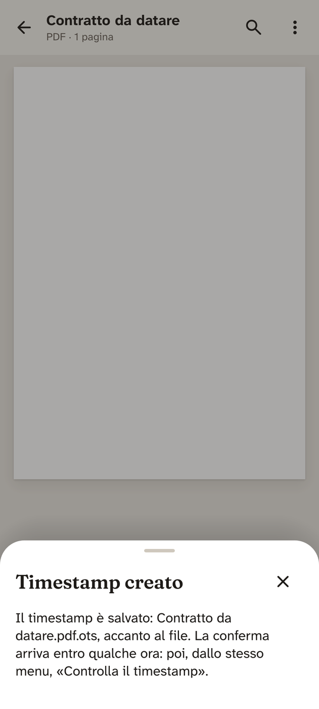</td><td align="center" width="25%">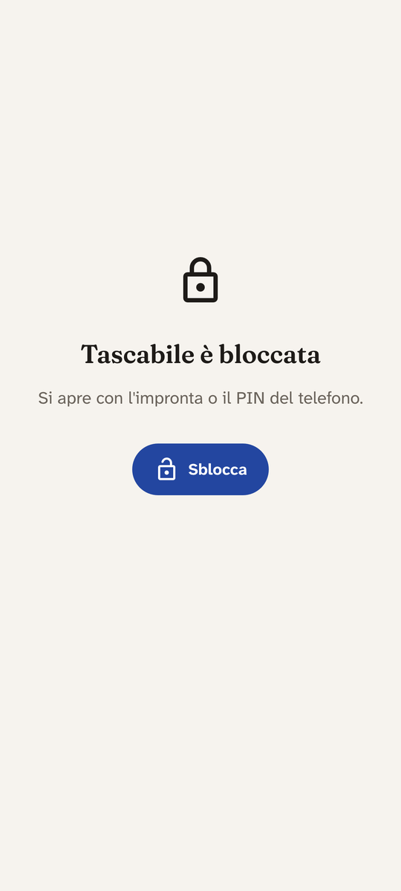</td><td align="center" width="25%">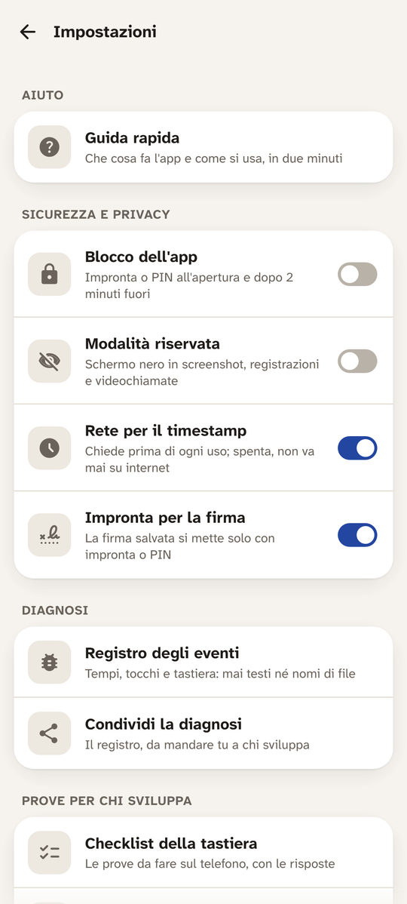</td></tr>
<tr><td align="center"><b>Spreadsheets</b> · Fogli di calcolo</td><td align="center"><b>Timestamp</b> · Timestamp</td><td align="center"><b>App lock</b> · Blocco</td><td align="center"><b>Settings</b> · Impostazioni</td></tr>
</table>

<sub>Screens drawn by the app itself in its tests (`app/tests/schermata.rs`), with made-up documents; the app is in Italian and the latest version may differ in small details. · Schermate disegnate dall'app nei suoi test, con documenti inventati; l'ultima versione può differire in piccoli dettagli.</sub>

---

## English

Doc Tascabile opens, writes and signs documents on an Android phone, with controls placed for the thumb. It is written in Rust on top of open-source document engines, works without an account and without the Internet, and keeps the files on the phone.

### What it does

| Area | What you can do |
|---|---|
| **Text documents** | Open and write .docx files (and open .doc, .odt, .rtf, .txt). Styles, bold, italic, underline, lists, tables, images, date, page break, track changes, page view with numbers, find, Italian spell check. Save, save a copy, export to PDF, share. New documents blank or from a template (minutes, report, letter, lesson). |
| **PDF** | Read with scrolling, pinch and search. Fill in forms, also where there is no field. Sign with the finger (three pen styles, black or blue) or from a photo of a signature on paper. Highlight, underline, notes, freehand drawing. Edit text in place, add text and images, redact permanently. Pages: reorder, rotate, merge, split; password, page numbers, watermark, compression, export to Word. «Copia definitiva» makes a flattened copy to send. |
| **Scans** | Scan sheets with the camera or from the gallery: edges found automatically, adjustable by dragging corners and side points (also for folded sheets), four looks, an eraser for stains and shadows. Text recognition on the phone; in a recognised scan a name or a date can be corrected, redrawn in the photo in the closest typeface. |
| **Slides** | Read .pptx, .ppsx, .potx with thumbnails and notes. Present full screen: tap or volume keys to move, pen, black screen, slide grid. With HDMI or Miracast the slides go to the projector and the notes stay on the phone. PDF of the slides, with notes too. |
| **Spreadsheets** | Read .xlsx, .xlsm, .xls, .xlsb, .ods, .csv, .tsv: grid, sheets, frozen rows and columns, zoom. Values are those saved in the file, without recalculation. Read only. |
| **Timestamp** | Optional proof that a saved file existed at a given moment, made with OpenTimestamps and saved next to the file as `.ots`. |
| **Safety nets** | App lock with fingerprint or PIN, fingerprint before placing the saved signature, private mode that blacks out screenshots and screen sharing, recovery of unsaved work after a crash. |

### Limits

Open your own documents or documents from people you know: the app is not built for unknown files from the Internet. Slides are read and presented but not edited; spreadsheets are read only. Text recognition is for Italian. Scans saved as fax, JBIG2 or JPEG 2000 cannot be corrected. There is no dark theme yet.

A signature drawn with the finger is a simple electronic signature, not a qualified one. The OpenTimestamps timestamp is a public proof, not a qualified electronic time stamp under the eIDAS regulation, and it is not a signature. Recognised text can contain errors and must be read again.

### Privacy and permissions

Documents stay on the phone. There is no account, no advertising, no usage statistics. The app goes online only to create or check a timestamp, after asking every time (it can be switched off for good in the settings): the public servers (OpenTimestamps, blockstream.info, mempool.space) receive a fingerprint of the file mixed with a random number, never the document, and like any website they see the phone's Internet address. The diagnostic log holds times and taps, never texts or file names; it lives only in memory and leaves the phone only if you share it yourself.

| Permission | Why |
|---|---|
| Access to all files | To show and open the documents in the phone's folders (Download, Documents, WhatsApp, Telegram). |
| Internet | Only for the timestamp, after asking. |
| Biometrics | For the app lock and the signature. |
| Hide overlay windows | Stops other apps from drawing over Doc Tascabile. |

### Install

Tap **Download APK** at the top of this page on an Android phone (Android 11 or later), open the file and, when Android asks, allow installation from your browser or file manager. The app is not on Google Play yet. The SHA-256 fingerprint of each APK is in the release notes, to check that the file is the original.

### About the author

I am not a professional software developer: I am an enthusiast and I build apps in my spare time. Doc Tascabile was written with the help of AI tools (Claude, by Anthropic), and I played an active role in its architecture, features, project direction, design and technical review. It was checked with automated tests and on real phones, as carefully as I can. Inside the app, artificial intelligence is used in one place only: text recognition, done by two models that run on the phone, without the network. The app is offered free of charge, as is, without any warranty (see the [LICENSE](LICENSE)). If you find a problem, please report it.

### Build

You need Rust (the version written in `rust-toolchain.toml`), the Android SDK with NDK 28.2, Java 21 and `cargo-ndk`.

```bash
cd android
./build.sh            # test APK, debug key
./build.sh rilascio   # release APK, needs the release key (not in the repository)
```

### Licences

Doc Tascabile's own code is released under the [PolyForm Noncommercial License 1.0.0](LICENSE): anyone may read it, use it, change it and share it for noncommercial purposes. Commercial use requires a separate licence from the author, who keeps all other rights, including the name Doc Tascabile. The components it includes keep their own licences, with the licence file next to each of them in the repository:

| Component | Licence |
|---|---|
| WordCraft, PDFCraft and DeckCraft engines ([storytold](https://github.com/storytold)) | Apache 2.0 / MIT |
| PP-OCRv6 text recognition model (PaddlePaddle) | Apache 2.0 |
| Text detection model of [ocrs](https://github.com/robertknight/ocrs) by Robert Knight; ocrs and RTen code | CC BY-SA 4.0; code MIT / Apache 2.0 |
| Italian Hunspell dictionary (LibreItalia), unmodified | GPL 3.0 |
| Material Symbols icons | Apache 2.0 |
| Fonts: Fraunces and Atkinson Hyperlegible Next for the interface; Carlito, Caladea, Inter, Liberation Sans and Serif for slides and spreadsheets | SIL Open Font License |

Microsoft Word, Excel and PowerPoint are trademarks of Microsoft; WhatsApp and Telegram belong to their owners. Doc Tascabile is not affiliated with any of them and names them only to say which files it opens.

### Feedback

Problems and ideas: open an issue on this repository. For security problems use GitHub's private reporting (Security tab › Report a vulnerability), not a public issue.

---

## Italiano

Doc Tascabile apre, scrive e firma i documenti su un telefono Android, con i comandi a portata di pollice. È scritto in Rust sopra motori di documenti open source, funziona senza account e senza Internet, e tiene i file sul telefono.

### Cosa fa

| Area | Cosa si può fare |
|---|---|
| **Documenti di testo** | Aprire e scrivere file .docx (e aprire .doc, .odt, .rtf, .txt). Stili, grassetto, corsivo, sottolineato, elenchi, tabelle, immagini, data, salto pagina, revisioni, vista pagina coi numeri, trova, controllo ortografico in italiano. Salva, salva una copia, esporta in PDF, condividi. Documenti nuovi vuoti o da un modello (verbale, relazione, lettera, lezione). |
| **PDF** | Leggere scorrendo, col pizzico e con la ricerca. Compilare i moduli, anche dove non c'è un campo. Firmare col dito (tre tratti, nero o blu) o dalla foto di una firma su carta. Evidenziare, sottolineare, note, disegno a mano libera. Modificare il testo sul posto, aggiungere testo e immagini, oscurare per sempre. Pagine: ordine, rotazione, unione, divisione; password, numeri di pagina, filigrana, compressione, esportazione in Word. «Copia definitiva» fa una copia da mandare con tutto fissato nella pagina. |
| **Scansioni** | Scansionare i fogli con la fotocamera o dalla galleria: bordi trovati da soli, da sistemare trascinando gli angoli e i punti sui lati (anche per i fogli piegati), quattro aspetti, una gomma per macchie e ombre. Riconoscimento del testo sul telefono; in una scansione riconosciuta si corregge un nome o una data, ridisegnati nella foto nel carattere più simile. |
| **Slide** | Leggere .pptx, .ppsx, .potx con miniature e note. Presentare a tutto schermo: tocco o tasti del volume per andare avanti, penna, schermo nero, griglia delle slide. Con HDMI o Miracast le slide vanno sul proiettore e le note restano sul telefono. PDF delle slide, anche con le note. |
| **Fogli di calcolo** | Leggere .xlsx, .xlsm, .xls, .xlsb, .ods, .csv, .tsv: griglia, fogli, righe e colonne bloccate, zoom. I valori sono quelli salvati nel file, senza ricalcolo. Sola lettura. |
| **Timestamp** | Prova facoltativa che un file salvato esisteva in un certo momento, fatta con OpenTimestamps e salvata accanto al file come `.ots`. |
| **Reti di sicurezza** | Blocco dell'app con impronta o PIN, impronta prima di mettere la firma salvata, modalità riservata che oscura screenshot e condivisione dello schermo, recupero del lavoro non salvato dopo una chiusura improvvisa. |

### Limiti

Aprire documenti propri o di persone che si conoscono: l'app non è fatta per file sconosciuti presi da Internet. Le slide si leggono e si presentano ma non si modificano; i fogli di calcolo sono in sola lettura. Il riconoscimento del testo è per l'italiano. Le scansioni salvate come fax, JBIG2 o JPEG 2000 non si correggono. Il tema scuro non c'è ancora.

La firma fatta col dito è una firma elettronica semplice, non qualificata. Il timestamp di OpenTimestamps è una prova pubblica, non una validazione temporale elettronica qualificata secondo il regolamento eIDAS, e non è una firma. Il testo riconosciuto può avere errori e va riletto.

### Privacy e permessi

I documenti restano sul telefono. Niente account, pubblicità o statistiche d'uso. L'app va in rete solo per creare o controllare un timestamp, dopo averlo chiesto ogni volta (si può spegnere del tutto nelle Impostazioni): i server pubblici (OpenTimestamps, blockstream.info, mempool.space) ricevono un'impronta del file mescolata con un numero a caso, mai il documento, e come ogni sito vedono l'indirizzo internet del telefono. Il registro della diagnosi tiene tempi e tocchi, mai testi o nomi di file; sta solo in memoria ed esce dal telefono solo se lo condividi tu.

| Permesso | Perché |
|---|---|
| Accesso a tutti i file | Per mostrare e aprire i documenti nelle cartelle del telefono (Download, Documenti, WhatsApp, Telegram). |
| Internet | Solo per il timestamp, dopo averlo chiesto. |
| Biometria | Per il blocco dell'app e per la firma. |
| Nascondere le finestre sovrapposte | Impedisce ad altre app di disegnare sopra Doc Tascabile. |

### Installare

Tocca **Download APK** in cima a questa pagina da un telefono Android (Android 11 o successivo), apri il file e, quando Android lo chiede, consenti l'installazione dal browser o dal gestore dei file. L'app non è ancora su Google Play. L'impronta SHA-256 di ogni APK è nelle note della release, per controllare che il file sia l'originale.

### Chi la sviluppa

Non sono un programmatore professionista ma un appassionato, che sviluppa app nel tempo libero. Doc Tascabile è stato scritto con l'aiuto di strumenti di intelligenza artificiale (Claude, di Anthropic), e io ho svolto un ruolo attivo nell'architettura, nelle funzionalità, nella direzione del progetto, nel design e nel controllo tecnico. È stato controllato con prove automatiche e su telefoni veri, con tutta la cura che posso. Dentro l'app l'intelligenza artificiale c'è in un punto solo: il riconoscimento del testo, fatto da due modelli che girano sul telefono, senza rete. L'app è offerta gratis, così com'è, senza garanzie di alcun tipo (vedi la [LICENSE](LICENSE)). Se trovi un problema, segnalalo.

### Compilare

Servono Rust (la versione scritta in `rust-toolchain.toml`), l'SDK Android con l'NDK 28.2, Java 21 e `cargo-ndk`.

```bash
cd android
./build.sh            # APK di prova, chiave di debug
./build.sh rilascio   # APK di rilascio, serve la chiave vera (non sta nel repository)
```

### Licenze

Il codice di Doc Tascabile è distribuito con la [PolyForm Noncommercial License 1.0.0](LICENSE): chiunque può leggerlo, usarlo, modificarlo e condividerlo per scopi non commerciali. L'uso commerciale richiede una licenza separata dall'autore, che si tiene tutti gli altri diritti, compreso il nome Doc Tascabile. I componenti inclusi tengono le loro licenze, col file della licenza accanto a ciascuno nel repository:

| Componente | Licenza |
|---|---|
| Motori WordCraft, PDFCraft e DeckCraft ([storytold](https://github.com/storytold)) | Apache 2.0 / MIT |
| Modello PP-OCRv6 per il riconoscimento del testo (PaddlePaddle) | Apache 2.0 |
| Modello di rilevamento del testo di [ocrs](https://github.com/robertknight/ocrs), di Robert Knight; codice di ocrs e RTen | CC BY-SA 4.0; codice MIT / Apache 2.0 |
| Dizionario italiano Hunspell (LibreItalia), non modificato | GPL 3.0 |
| Icone Material Symbols | Apache 2.0 |
| Caratteri: Fraunces e Atkinson Hyperlegible Next per l'interfaccia; Carlito, Caladea, Inter, Liberation Sans e Serif per slide e fogli di calcolo | SIL Open Font License |

Microsoft Word, Excel e PowerPoint sono marchi di Microsoft; WhatsApp e Telegram appartengono ai loro titolari. Doc Tascabile non è collegato a nessuno di loro e li nomina solo per dire quali file apre.

### Segnalazioni

Problemi e idee: apri una issue su questo repository. Per i problemi di sicurezza usa la segnalazione privata di GitHub (scheda Security › Report a vulnerability), non una issue pubblica.
